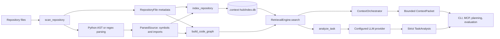

# ContextHub

ContextHub is a Python CLI for turning a code repository into bounded,
inspectable context for AI-assisted development. It scans files, extracts
language-aware metadata, builds a local SQLite index and code graph, retrieves
relevant evidence, and can ask a configured LLM provider for structured task
analysis.

It is aimed at developers, reviewers, and coding-agent workflows that need
repeatable repository understanding before planning or implementation. The
local indexing and retrieval pipeline is deterministic; provider-backed task
analysis remains subject to model availability and response quality. ContextHub
does not apply generated patches, execute arbitrary agent commands, guarantee
semantic correctness, or claim fully grounded answers.

## Features

- Deterministic repository scanning with file size, line count, modification
  time, SHA-256 content hashes, detected language, and parse results.
- Exclusions for common generated/dependency directories, `.gitignore` rules,
  binary files, symlink escapes, and likely secret files such as `.env`,
  credentials, secrets, `.pem`, `.key`, and `.p12` files.
- Language detection for Python, JavaScript/TypeScript, Java, C/C++, Go, Rust,
  HTML, CSS, JSON, YAML, Markdown, SQL, and shell files.
- Python AST parsing plus deterministic regex-based symbol/import extraction
  for several other languages. Parse failures are retained as metadata.
- Incremental SQLite indexing with new, modified, and deleted file tracking.
- Symbol and import metadata, direct dependencies, dependents, and an
  in-memory code graph with resolved and unresolved import relationships.
- Lexical search with symbol, path/import, and bounded graph signals.
- Bounded context packets with file, token, character, and graph budgets.
- Configurable Nebius and NVIDIA OpenAI-compatible providers, plus a
  deterministic `MockProvider` for offline packet flows.
- Strict structured task analysis with optional provider usage metadata kept
  outside the task-analysis schema.
- Read-only MCP, planning, proposal, validation, and offline evaluation
  commands.

## Architecture and pipeline



`ctx scan` performs discovery and parsing in memory. `ctx index` persists file
and parsed-source metadata to `.context-hub/index.db`. Graph construction uses
the scanned repository model and represents files, symbols, imports,
dependencies, and unresolved relationships in memory. Search reads the local
index and uses graph signals where available. Packet assembly combines search
evidence with explicit budgets. `ctx analyze` builds a bounded task prompt and
sends it to the selected provider; it does not itself produce a complete
architecture answer.

The MCP server, read-only planning tools, proposal generation, validation, and
evaluation suites are implemented integrations. Embeddings, vector databases,
automatic patch application, arbitrary agent execution, and guaranteed
semantic grounding are not implemented.

See [docs/architecture.md](docs/architecture.md) and
[docs/providers.md](docs/providers.md) for deeper details.

## Installation and quick start

Requirements are Python 3.12+ and [uv](https://docs.astral.sh/uv/). From
Windows Command Prompt in a checkout:

```bat
uv sync
uv run ctx --help
uv run ctx init .
uv run ctx scan .
uv run ctx index .
uv run ctx search "context packet assembly" --limit 5
uv run ctx graph .
uv run ctx pack "Explain how ContextOrchestrator builds a context packet" --no-llm
```

`uv sync` installs the project declared in `pyproject.toml`; the `ctx` console
script is registered as `context_hub.cli:app`. `ctx init` creates local
`.context-hub/metadata.json`; `ctx index` creates or updates the SQLite index.
The `--no-llm` packet path uses deterministic local analysis and needs no API
key or network access.

## CLI reference

Run `uv run ctx --help` or `uv run ctx <command> --help` for generated help.

### Project and repository commands

| Command | Arguments and options | Purpose |
|---|---|---|
| `ctx version` | None | Print the package version. |
| `ctx init [PATH]` | Optional path, default `.` | Create ContextHub metadata. |
| `ctx status [PATH]` | Optional path, default `.` | Show project and index status. |
| `ctx scan [PATH]` | Optional path, default `.` | Scan files and report repository intelligence. |
| `ctx index [PATH]` | Optional path, default `.`; `--force` | Create or incrementally update the index; `--force` reparses discovered files. |
| `ctx inspect PATH` | Required repository-relative file | Show metadata, symbols, and imports. |
| `ctx symbols PATH` | Required repository-relative file | List discovered symbols. |
| `ctx graph [PATH]` | Optional path, default `.` | Build and summarize the code graph. |
| `ctx deps PATH` | Required repository-relative file | Show direct dependencies. |
| `ctx dependents PATH` | Required repository-relative file | Show dependent files. |
| `ctx search QUERY` | Required query; `--limit 1..100` default `20`; `--path PREFIX`; `--explain` | Search indexed context using lexical and graph signals. |

Examples:

```bat
uv run ctx status .
uv run ctx inspect src/context_hub/cli.py
uv run ctx symbols src/context_hub/cli.py
uv run ctx deps src/context_hub/orchestration/orchestrator.py
uv run ctx search "how context packets are assembled" --limit 5 --explain
```

### Context and task analysis

```text
ctx pack TASK [--max-files N] [--max-tokens N] [--no-llm] [--json]
ctx analyze TASK [--limit N] [--json]
```

`ctx pack` assembles a bounded context packet. `--no-llm` selects the local
mock provider; without it, credentials may be required. `ctx analyze` retrieves
repository evidence and requests structured task analysis from the selected
provider. Neither command applies repository changes.

```bat
uv run ctx pack "Trace repository indexing" --max-files 8 --max-tokens 4000 --no-llm
uv run ctx analyze "Explain the project architecture, identify the main modules, and trace how data flows between them."
uv run ctx analyze "Explain the project architecture" --json
```

### Provider and additional commands

`ctx provider status` prints the selected provider, model, endpoint, and only
whether its API key is configured. It makes no network request.

```bat
uv run ctx provider status
```

The CLI also registers `ctx benchmark-validate`, `ctx agent-plan`, `ctx mcp
serve`, `ctx agent propose`, `ctx agent validate`, and the evaluation commands
`ctx eval retrieval`, `packets`, `performance`, `agent`, and `all`. Use their
generated help for complete options; see [docs/cli.md](docs/cli.md),
[docs/mcp.md](docs/mcp.md), and [docs/evaluation.md](docs/evaluation.md).

## NVIDIA Nemotron configuration

In Windows Command Prompt:

```bat
set CONTEXT_HUB_PROVIDER=nvidia
set NVIDIA_API_KEY=<set-outside-the-repository>
set NVIDIA_BASE_URL=https://integrate.api.nvidia.com/v1
set NVIDIA_MODEL=nvidia/nemotron-3.5-super-vl-120b-a12b
set NVIDIA_REASONING_EFFORT=none
uv run ctx provider status
uv run ctx analyze "Explain the project architecture, identify the main modules, and trace how data flows between them."
```

The hosted route is `https://integrate.api.nvidia.com/v1/chat/completions`.
The model ID must be the exact hosted identifier enabled for the NVIDIA API
account; a public catalog listing does not guarantee account entitlement. The
documented reasoning control supports `none`, `low`, and `high`; `none` is the
ContextHub default for task analysis so output budget remains for user-facing
JSON. `CONTEXT_HUB_MAX_TOKENS` controls the shared output budget.

Nebius remains supported when explicitly selected:

```bat
set CONTEXT_HUB_PROVIDER=nebius
set NEBIUS_API_KEY=<set-outside-the-repository>
set NEBIUS_BASE_URL=https://api.tokenfactory.nebius.com/v1
set NEBIUS_MODEL=nvidia/nemotron-3-super-120b-a12b
uv run ctx provider status
```

Never place keys in the repository. Explicit NVIDIA selection never falls back
to Nebius.

## Task analysis example

A successful architecture task analysis identifies a task type such as
`architecture_explanation`, domains covering software architecture, project
structure, and data flow, likely files such as `docs/architecture.md` and
modules under `src/context_hub/`, symbols such as `init_project`,
`project_status`, and `data`, and required context such as package structure and
imports. The example result has confidence `0.45`.

This output identifies likely files, symbols, required context, and
ambiguities. It is a structured retrieval/analysis aid, not necessarily a
completed architecture explanation or a fully grounded answer.

```bat
uv run ctx analyze "Explain the project architecture, identify the main modules, and trace how data flows between them."
```

## Limitations and troubleshooting

- Python parsing uses the AST. Other supported languages use deterministic
  regex parsing, so symbols/imports may be incomplete. Parse errors and
  unresolved imports are retained as metadata.
- Generated files, secrets, binary files, symlink escapes, ignored paths, and
  excluded directories are not indexed. Rebuild stale local state with
  `uv run ctx init .` and `uv run ctx index .`.
- Search, inspection, graph commands, and `ctx pack --no-llm` are local.
  Provider-backed analysis, ordinary packet building, planning, proposals, and
  some MCP operations require credentials and network access.
- NVIDIA `401` indicates authentication failure, `403` access denial, `404`
  may indicate a model/endpoint mismatch or account entitlement, `429` rate or
  quota limiting, and `5xx` an upstream failure. Check exact model and endpoint
  values; ContextHub does not switch providers automatically.
- A successful HTTP response can still be unusable if it returns only reasoning,
  requests unsupported tool execution, is refused, or exhausts its output
  limit. ContextHub reports these conditions rather than substituting private
  reasoning or fabricating task-analysis fields.
- Embeddings, vector databases, guaranteed answer grounding, exact model-token
  savings, and semantic correctness guarantees are not implemented.

Start diagnostics with:

```bat
uv run ctx provider status
uv run ctx analyze "Explain the project architecture" --json
```

## Development and testing

Install the locked environment and run the configured test suite:

```bat
uv sync
uv run --locked --with pytest==8.3.5 pytest
```

Tests use mocked HTTP transports for provider behavior; live API keys are not
required. Keep credentials outside tracked files.

## Roadmap

Future work may include broader grammar-backed parsing, richer dependency
resolution, additional provider response modes, and deeper agent integrations.
These are roadmap items, not shipped functionality.

## Related documentation

- [Architecture and data flow](docs/architecture.md)
- [CLI reference](docs/cli.md)
- [Provider configuration](docs/providers.md)
- [MCP setup and tools](docs/mcp.md)
- [Evaluation and benchmarks](docs/evaluation.md)
- [Troubleshooting](docs/troubleshooting.md)
- [Contributing](docs/contributing.md)
