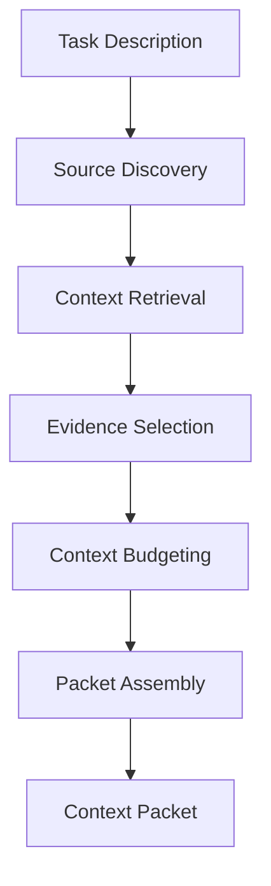

# Context Hub

### Give AI the context it needs to think better.

Context Hub is a developer-focused context engineering system designed to retrieve, select, prioritize, and package relevant information for AI tasks. It helps developers prepare structured, task-specific context from project files instead of manually assembling large prompts.

---

## Table of Contents

- [Overview](#overview)
- [The Problem](#the-problem)
- [Goals](#goals)
- [How It Works](#how-it-works)
- [Architecture](#architecture)
- [Core Components](#core-components)
- [Context Packet](#context-packet)
- [Installation](#installation)
- [CLI Reference](#cli-reference)
- [Development Workflow](#development-workflow)
- [Testing](#testing)
- [Design Principles](#design-principles)
- [Limitations](#limitations)
- [Future Directions](#future-directions)
- [Contributing](#contributing)

---

## Overview

AI systems depend heavily on the context provided to them. When working with an unfamiliar codebase or a large software project, developers often spend considerable time identifying relevant files, extracting useful information, and preparing prompts.

Context Hub treats context preparation as a dedicated engineering process.

Rather than simply passing large amounts of information to an AI model, it provides a pipeline for collecting potentially relevant evidence, selecting useful information, managing a context budget, and assembling a task-specific context packet.

The goal is to make context preparation more structured, inspectable, and reusable.

## The Problem

Developers using AI coding assistants and agentic systems frequently encounter several challenges:

- **Context fragmentation:** Relevant information is distributed across source files, configuration files, and documentation.
- **Information overload:** Supplying too much context can distract an AI model from the actual task.
- **Limited context windows:** Models have practical limits on the amount of information they can process at once.
- **Manual preparation:** Developers repeatedly collect and summarize project information.
- **Poor traceability:** It can be difficult to determine which sources influenced a model's response.
- **Redundant evidence:** Multiple files may contain overlapping information that consumes unnecessary context.

Context Hub aims to address these challenges through a structured context preparation pipeline.

## Goals

Context Hub is designed to:

- Retrieve information relevant to a given task.
- Select useful evidence from available project sources.
- Manage context size through a budgeting stage.
- Assemble structured context packets.
- Make context preparation easier to inspect and debug.
- Provide a developer-friendly command-line interface.
- Establish a foundation for more advanced context engineering workflows.

## How It Works

Context Hub follows a task-oriented pipeline.



### Pipeline stages

1. **Task input:** Receive a natural-language description of the task.
2. **Source discovery:** Identify available project files and other supported sources.
3. **Retrieval:** Find candidate information relevant to the task.
4. **Evidence selection:** Determine which retrieved information is useful enough to retain.
5. **Context budgeting:** Manage the selected evidence against the configured or estimated context limit.
6. **Packet assembly:** Organize the selected information into a structured packet.
7. **Output:** Return the packet for inspection or use in a downstream AI workflow.

The exact algorithms and internal data structures are implementation-dependent.

## Architecture

Context Hub separates context preparation into logical responsibilities.

### Context orchestration

The context orchestrator coordinates the pipeline. It connects retrieval, evidence selection, budgeting, and packet assembly into a single task-oriented workflow.

### Retrieval layer

The retrieval layer identifies candidate information from available sources. Depending on the implementation, retrieval can use lexical matching, semantic similarity, metadata, or other ranking techniques.

### Evidence selection layer

The evidence selection layer reduces the candidate set to information useful for the task while accounting for relevance, overlap, and size.

### Budgeting layer

The budgeting layer manages the amount of evidence that can be included in the packet. The accuracy of its estimates depends on the counting method and any tokenizer used.

### Packet assembly layer

The packet assembly layer combines the task description and selected evidence into the output format supported by the project.

These are conceptual responsibilities, not a claim that every stage is implemented as an independent module.

## Core Components

### Context retrieval

Retrieval finds potentially relevant information for the current task.

A useful retrieval system should make it possible to identify the source of each result and investigate why particular content was selected.

### Embeddings

Text embeddings represent content as numerical vectors. When supported by the configured retrieval implementation, semantic similarity can help identify conceptually related content even when the wording differs.

The embedding model, storage mechanism, and similarity algorithm must be verified against the actual implementation.

### Evidence selection

Evidence selection determines which retrieved content should enter the final packet. Its purpose is to preserve useful information without unnecessarily including irrelevant or redundant material.

### Context budgeting

Context budgeting accounts for the space available to the final packet. Depending on the implementation, this may use token estimates, character counts, or another measurement.

### Packet assembly

Packet assembly produces the final task-specific context output. The packet should make its task and included sources identifiable.

## Context Packet

A context packet is the output of the context preparation pipeline.

A packet may contain:

- The original task description.
- The files or sources selected for the task.
- Relevant extracted content or evidence.
- Context size estimates.
- Additional metadata supported by the implementation.

For example, a task might ask Context Hub to explain how a particular orchestration component builds a context packet.

```bash
uv run ctx pack "Explain how ContextOrchestrator builds a context packet, including retrieval, evidence selection, budgeting, and packet assembly."
```

The CLI can then produce a packet describing the task and the selected files or evidence, according to the current implementation.

A context packet is intended to prepare information for downstream reasoning; it does not itself guarantee that an AI model's eventual answer will be correct.

## Installation

Context Hub's development workflow uses Python and `uv`.

### Prerequisites

- Python compatible with the project's declared requirements.
- [`uv`](https://docs.astral.sh/uv/) for dependency and environment management.
- A local checkout of the Context Hub repository.

### Set up the project

Clone the repository and enter its directory:

```bash
git clone <YOUR_REPOSITORY_URL>
cd <YOUR_REPOSITORY_DIRECTORY>
```

Install the project dependencies:

```bash
uv sync
```

**Note:** Replace the repository placeholders with the actual Git URL and directory name. Use the Python version and setup requirements declared by the project.

## CLI Reference

Context Hub exposes a command-line interface named `ctx`.

Run the commands below from the project root.

### General commands

| Command | Purpose |
|---|---|
| `uv run ctx --help` | Display the CLI help and available commands. |
| `uv run ctx --version` | Display the version, if version support is implemented. |

### Context packing

#### `ctx pack`

**Syntax**

```bash
uv run ctx pack "Your task description"
```

**Purpose:** Build a context packet for a specific task.

**Example**

```bash
uv run ctx pack "Explain the architecture of this project."
```

A more specific example:

```bash
uv run ctx pack "Explain how ContextOrchestrator builds a context packet, including retrieval, evidence selection, budgeting, and packet assembly."
```

**Typical use cases**

- Prepare context for an AI coding task.
- Investigate an unfamiliar module.
- Gather relevant project information before an architectural review.
- Inspect which files are selected for a task.

The exact output fields depend on the current implementation.

### Command-specific help

```bash
uv run ctx pack --help
```

Use this command to inspect the supported arguments and options for `pack`.

### Development commands

These commands support the development workflow; they are not necessarily `ctx` subcommands.

| Command | Purpose |
|---|---|
| `uv sync` | Install dependencies declared by the project. |
| `uv run ctx --help` | Inspect the CLI and verify that its entry point is available. |
| `uv run pytest` | Run the test suite if the project uses pytest. |

**Command availability:** `ctx pack` is the documented primary workflow. Confirm optional commands such as `--version` and any additional subcommands against `uv run ctx --help` before relying on them.

## Development Workflow

A typical development workflow is:

1. Install dependencies using `uv sync`.
2. Inspect the CLI using `uv run ctx --help`.
3. Run a representative `ctx pack` task.
4. Inspect the generated packet.
5. Investigate retrieval and evidence-selection behavior.
6. Verify context budgeting and packet assembly.
7. Run the available automated tests.
8. Update documentation when command behavior or output formats change.

### Example investigation task

```bash
uv run ctx pack "Trace the flow of information from task input to final context packet."
```

This is useful when studying the pipeline or investigating how the orchestrator coordinates its stages.

## Testing

Run the project's tests using the test runner configured by the repository.

For a project using pytest:

```bash
uv run pytest
```

Testing should cover the components that exist in the implementation, including:

- Task input validation.
- Source discovery.
- Retrieval behavior.
- Evidence selection.
- Budget enforcement.
- Packet assembly.
- CLI argument handling.
- Error handling for invalid inputs and unavailable sources.

This list describes recommended coverage, not a claim that every test is already present.

## Design Principles

### Task-oriented context

Context should be assembled around the task instead of collected indiscriminately.

### Explicit evidence

Selected information should be inspectable so developers can understand what was included.

### Budget awareness

Context preparation should account for the capacity available to downstream AI systems.

### Modularity

Retrieval, selection, budgeting, and packet assembly should have understandable responsibilities.

### Reproducibility

The system should make its behavior explainable and repeatable where possible.

### Developer experience

Context preparation should be accessible through a straightforward CLI.

## Limitations

Context Hub should not be assumed to:

- Retrieve every relevant piece of information.
- Guarantee factual correctness of source documents.
- Eliminate hallucinations in downstream models.
- Support every file type or external source.
- Produce exact model-token counts without suitable tokenization.
- Integrate automatically with every AI coding assistant.
- Guarantee improved model performance without evaluation.

Actual limitations depend on the current implementation and configuration.

## Future Directions

Potential directions for further development include:

- Additional retrieval strategies.
- Improved evidence ranking and deduplication.
- More precise token-budget estimation.
- Context packet inspection and debugging tools.
- Retrieval-quality evaluation and benchmarks.
- Integrations with coding assistants and agent frameworks.
- More detailed pipeline observability.
- Improved reproducibility across runs.

These are potential development directions and are not represented as completed features.

## Contributing

Contributions should improve correctness, maintainability, testability, or developer experience.

A suggested contribution workflow:

1. Understand the relevant component and its responsibilities.
2. Make a focused change.
3. Add or update tests.
4. Run the project's test suite.
5. Update the documentation if behavior changes.
6. Submit a pull request explaining the change and its motivation.

